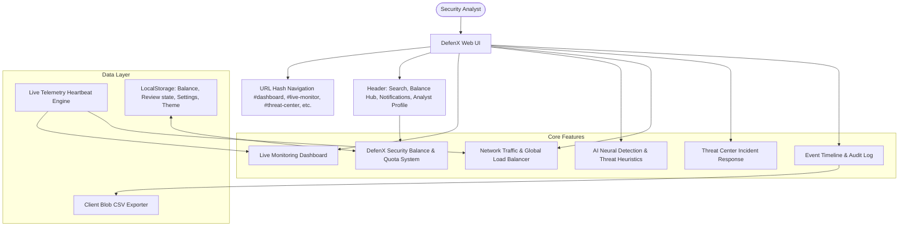

# DefenX — AI Cybersecurity & Threat Intelligence Platform

DefenX is an enterprise-grade AI cybersecurity and endpoint intelligence dashboard built with Next.js (App Router), React 19, and Tailwind CSS. It delivers real-time system performance telemetry, behavioral anomaly detection, incident response, network topology analysis, and automated security containment.

---

## 🛡️ Architecture & Data Flow



---

## 🚀 Key Features

### 1. DefenX Balance Hub ("The Balance Thing")
- **Defense Operations Balance**: Real-time credit metering for AI threat inference, deep sandbox verification, and network inspection throughput.
- **Interactive Topbar Pill**: Displays current credit balance (`2,450 Cr`) with live status indicators.
- **Instant Recharge**: One-click credit top-up (+250, +1,000, +5,000 credits).
- **AI Query Deductions**: Live deduction of credits with balance validation when querying the neural assistant.

### 2. Global Load Balancer & Traffic Distribution
- **Multi-Region Cluster Monitoring**: Real-time traffic balancing across US-East, EU-Central, and AP-South nodes.
- **Dynamic Balancing Algorithm**: Weighted Least Connections (L4/L7 Hybrid) with active health checks and sub-second failover.

### 3. Live Telemetry Heartbeat
- **Real-Time Oscillating Metrics**: Live CPU usage, memory consumption, download speeds, and upload rates that dynamically update in real time.
- **Interactive Timeframes**: Filter telemetry across 1h, 6h, 24h, and 7d periods.

### 4. AI Behavioral Detection & Neural Assistant
- **Live Anomaly Classifier**: Multi-stage demo analysis simulation with animated progress bar and process verification.
- **Intelligent Assistant**: Context-aware reasoning about network connections, active processes, suspicious payloads, and security balances.

### 5. Containment & Incident Response
- **Alert Triage**: Interactive review workflow with evidence modals and review status tracking.
- **Audit Reports**: Export security overviews, threat histories, and system performance as CSV spreadsheets.

---

## 🛠️ Getting Started

### Prerequisites
- Node.js 18+ or 20+
- npm or pnpm

### Installation & Development
```bash
# Install dependencies
npm install

# Start the live development server on port 8443
npm run dev

# Build for production
npm run build

# Start production server on port 8443
npm run start
```

### Keyboard Shortcuts
- `Ctrl + K` or `Cmd + K`: Jump to global threat, process, and log search.
